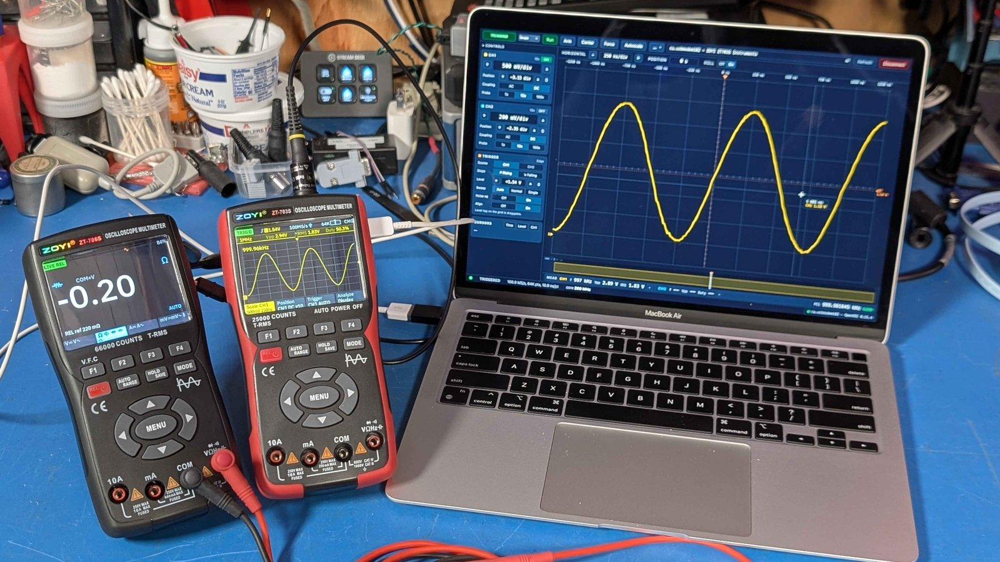

# ZOYI ZT703S / ZT706S desktop app

A desktop front end for the ZOYI ZT703S and ZT706S scopemeters running
[OpenOSC](https://github.com/bve/OpenOSC) firmware. It talks to the meter over
USB using OpenOSC's SCPI commands and gives you a big, live oscilloscope view
on your computer, plus panels for the multimeter and the signal generator.

It runs on Windows, macOS and Linux.

The speed comes from the firmware: OpenOSC adds SCPI extensions made for a
desktop app. One `WAV:FRAM?` query returns both channels of the same
acquisition, each with its scaling, in a single binary block, `WAV:ENV?` sends a
min/max envelope of the full record for the overview strip, `WAV:MEAS?` has
the meter compute the measurements itself, and peak decimation
(`WAV:POIN:MODE PEAK`) keeps short glitches visible in a zoomed-out view. With
plain per-setting queries and raw sample dumps the same view would take many
round trips per frame.

## What it does

- Live waveforms from both channels, drawn with sin(x)/x interpolation or as
  plain lines, with optional persistence and an XY mode.
- An overview strip under the plot showing the whole capture buffer, with a box
  marking what is on screen. Drag or scroll to move around in the record.
- Timebase, V/div, offset and trigger controls that change the meter directly,
  plus Run/Stop, Single, Force and Auto.
- Roll mode at slow timebases.
- A measurement bar (frequency, period, Vpp, RMS and so on) and time/voltage
  cursors.
- Multimeter and signal generator pages that switch in when the meter is in
  DMM or GEN mode.
- Screenshots of the meter's own display (Ctrl+P), saved and copied to the
  clipboard.
- CSV export of the frame on screen (Ctrl+S) or of the whole record.
- A "clean view" (F11) that shows just the plot, handy for screen recording.

Keyboard: Space starts or stops, A arms a single capture, C centres the
trigger point.

## Requirements

- A ZOYI ZT703S or ZT706S with OpenOSC firmware, version 0.21.9 or later
  (the first release with the desktop SCPI extensions above).
- USB data needs the meter's high-speed clock profile. If the app connects but
  sees no data, check the clock setting on the meter.

## Download

Ready-made builds for Windows, macOS and Linux are on the
[Releases](../../releases) page.

- **Windows:** unzip and run `zoyi_gui.exe`. It is a single static executable,
  nothing to install.
- **macOS:** for Apple Silicon Macs (M1 and later) on a recent macOS. Unzip and
  move `ZoyiGUI.app` to Applications. The app is not signed with a paid Apple
  developer ID, so the first time you have to right-click it, choose Open, and
  confirm. On an Intel Mac, build it from source (see below).
- **Linux:** an AppImage for x86-64 distributions from about 2022 on (Ubuntu
  22.04, Debian 12, Fedora 36 or newer). Make it executable
  (`chmod +x zoyi_gui-linux-x86_64.AppImage`) and run it. To open the meter's
  port your user needs to be in the `dialout` group (`uucp` on Arch):
  `sudo usermod -aG dialout $USER`, then log in again. If it says FUSE is
  missing, install `libfuse2` (`libfuse2t64` on Ubuntu 24.04), or run it with
  `--appimage-extract-and-run`.

## Using it

On the meter, turn on **Settings → Files & USB → USB Remote** first (hold MENU
to leave it later); the app talks to the meter through it.

Plug the meter in over USB, start the app and pick the meter's serial port
from the toolbar (it shows up as a COM port on Windows, `/dev/cu.usbmodem...`
on macOS and `/dev/ttyACM...` on Linux). With Auto-reconnect on, the app finds
the meter again after a mode change or an unplug.

You can also pass the port on the command line to connect straight away:

    zoyi_gui COM5
    zoyi_gui -v /dev/ttyACM0      (-v also prints the SCPI traffic)

## Building

The app is plain C++17 and Qt 6 (Widgets and SerialPort), built with make.

**Windows** (MSYS2, static build): install [MSYS2](https://www.msys2.org/),
run `setup_msys2.sh` once from a UCRT64 shell, then `make`. The result is
`build/win/zoyi_gui.exe`. `build.sh` does the same when called from PowerShell.

**macOS** (Homebrew):

    brew install qt
    make -f Makefile.mac zip

**Linux** (Debian/Ubuntu package names):

    sudo apt install qt6-base-dev libqt6serialport6-dev
    make -f Makefile.linux

## Credits

Made by a few friends who wanted a bigger screen for their scopemeter.
OpenOSC, the firmware that makes all of this possible, is by
[bve](https://github.com/bve/OpenOSC).

## License

MIT, see [LICENSE](LICENSE).
